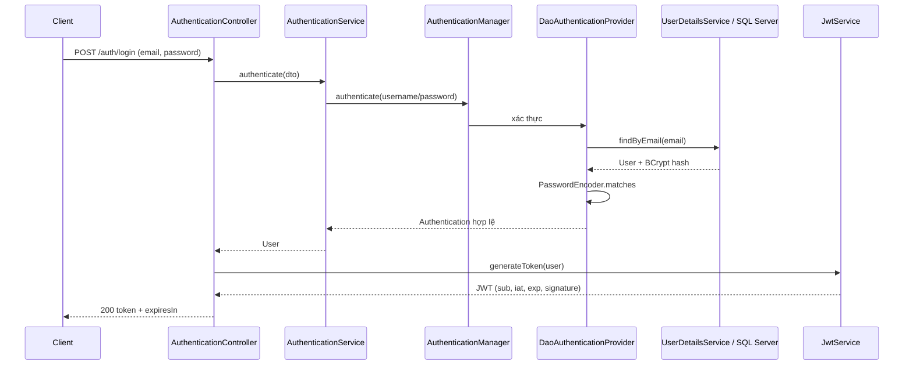

# SBA301 - Lab 06: Spring Security & JWT

Triển khai Core Lab theo [tài liệu trong docs](docs/SBA301_Lab06_Detailed_Step_by_Step_Spring_Security_JWT_Guide_V2.pdf): Java 21, Maven, Spring Boot 3.5.11, Spring Security, Spring Data JPA, SQL Server và JJWT **0.12.6**. Package gốc `fu.se.lab06jwt`, cổng **8005**, database **OrchidJWTLab**.

## Chạy dự án

Mở `pom.xml` bằng IntelliJ, chọn SDK 21 và reload Maven. Cấu hình SQL Server và các biến môi trường theo phần dưới, rồi chạy tại thư mục chứa `pom.xml`:

```powershell
# Kiểm thử tự động, không cần bật SQL Server hay cấu hình secret
.\mvnw.cmd clean test

# Khởi động API với SQL Server và biến môi trường đã khai báo
.\mvnw.cmd spring-boot:run
```

Maven Wrapper tự tải Maven 3.9.12 nếu cần, không yêu cầu cài `mvn` vào PATH. Dừng server bằng `Ctrl+C`. Nếu cổng 8005 đang được một lần chạy trước sử dụng, dừng lần chạy đó trước khi chạy lại.

Khi chạy trực tiếp `Lab06JwtApplication` trong IDE, khai báo `DB_USER`, `DB_PASSWORD`, `JWT_SECRET` trong Run Configuration. Spring Boot **không tự đọc** `.env`; file `.env.example` là mẫu tên biến để tham khảo.

## Thiết lập SQL Server và JWT

1. Cài JDK 21, SQL Server; kiểm tra SQL Server bật TCP/IP và đúng cổng.
2. Tạo database trong SSMS:

   ```sql
   IF DB_ID(N'OrchidJWTLab') IS NULL
       CREATE DATABASE OrchidJWTLab;
   GO
   ```

3. Khai báo thông tin kết nối và sinh một khóa JWT ngẫu nhiên trong PowerShell:

   ```powershell
   $env:DB_USER = 'sa'
   $env:DB_PASSWORD = '<mat-khau-SQL-Server>'
   $jwtKeyBytes = New-Object byte[] 32
   $jwtRng = [System.Security.Cryptography.RandomNumberGenerator]::Create()
   try {
       $jwtRng.GetBytes($jwtKeyBytes)
       $env:JWT_SECRET = [Convert]::ToBase64String($jwtKeyBytes)
   } finally {
       $jwtRng.Dispose()
   }
   ```

4. Khóa JWT là Base64 của ít nhất **32 byte ngẫu nhiên**. Nếu host/cổng khác, khai báo thêm `DB_URL` theo mẫu trong `.env.example`. Giữ cùng khóa giữa các lần chạy nếu muốn JWT còn hạn tiếp tục sử dụng được.
5. Chạy `.\mvnw.cmd spring-boot:run` trong cửa sổ PowerShell đã khai báo biến. Hibernate tạo bảng `users`; log phải có `Started Lab06JwtApplication` và `Tomcat started on port 8005`.

Không đưa `.env`, password database hoặc token thật vào bài nộp. Khóa trong `application-test.properties` chỉ dùng cho test. `ddl-auto=update` và `trustServerCertificate=true` giữ theo môi trường lab.

## API theo tài liệu

| API | Quyền truy cập | Thành công | Các lỗi cần kiểm tra |
| --- | --- | --- | --- |
| `POST /auth/signup` | Public | `201` + UserResponse | `400` dữ liệu sai; `409` email trùng |
| `POST /auth/login` | Public | `200` + token, expiresIn | `400` dữ liệu sai; `401` sai credential |
| `GET /users/me` | JWT hợp lệ | `200` + đúng principal | `401` thiếu/token lỗi/hết hạn |
| `GET /users` | JWT hợp lệ | `200` + danh sách UserResponse | `401` thiếu/token lỗi/hết hạn |

`/users` cho mọi người dùng đã xác thực theo **Core Lab**. Các track Advanced ở mục 23 là phần tự nghiên cứu của tài liệu.

Signup:

```http
POST http://localhost:8005/auth/signup
Content-Type: application/json

{
  "fullName": "SBA301 Student",
  "email": "student01@fpt.edu.vn",
  "password": "P@ssword123"
}
```

Login:

```http
POST http://localhost:8005/auth/login
Content-Type: application/json

{
  "email": "student01@fpt.edu.vn",
  "password": "P@ssword123"
}
```

Kết quả login có `token` và `expiresIn: 3600000` (**mili giây**, tức 1 giờ). Dùng `Authorization: Bearer <token>` cho hai API `/users`. UserResponse chỉ có `id`, `fullName`, `email`, `createdAt`, `updatedAt`.

## Postman và test matrix T01-T12

Tạo Postman Environment với `baseUrl = http://localhost:8005` và `token` để trống. Dùng các request signup/login ở trên. Trong Tests của login, lưu JWT bằng `pm.environment.set("token", pm.response.json().token)`; protected request dùng `Authorization: Bearer {{token}}`.

| Case | Thao tác | Kỳ vọng |
| --- | --- | --- |
| T01 | Signup hợp lệ | 201; SQL lưu BCrypt hash |
| T02 | Signup lại cùng email | 409; không thêm hàng trùng |
| T03 | Login đúng | 200; có token và expiresIn |
| T04 | Login sai password | 401; không có token |
| T05 | `/users/me` thiếu token | 401 |
| T06 | `/users/me` có token hợp lệ | 200; đúng email |
| T07 | `/users` có token hợp lệ | 200; không có password/hash |
| T08 | Gửi `Bearer abc` | 401 |
| T09 | Sửa một ký tự chữ ký JWT | 401 |
| T10 | Gửi token đã hết hạn | 401 |
| T11 | Signup email không hợp lệ | 400 |
| T12 | Signup password rỗng | 400 |

Để thử T10, dừng server, đặt `$env:JWT_EXPIRATION_TIME = '5000'`, khởi động lại, login và chờ hơn 5 giây trước khi gọi `/users/me`. Sau thử nghiệm, dừng server, chạy `Remove-Item Env:JWT_EXPIRATION_TIME` và khởi động lại để dùng TTL mặc định 3600000 ms.

Kiểm tra trong SSMS:

```sql
USE OrchidJWTLab;
SELECT id, full_name, email,
       LEFT(password, 7) + '...[masked]' AS password_hash_preview,
       LEN(password) AS password_hash_length
FROM dbo.users;
-- BCrypt hash dài 60 ký tự và khác plaintext.

SELECT email, COUNT(*) AS duplicate_count
FROM dbo.users
GROUP BY email
HAVING COUNT(*) > 1;
-- Kỳ vọng 0 hàng.
```

## Kiểm thử tự động

`SecurityContractTest` khởi động application context thật, dùng MockMvc qua SecurityFilterChain, DaoAuthenticationProvider, BCrypt, JJWT và JPA. H2 chỉ nằm trong dependency **test** và profile `test`, giúp `mvn test` chạy độc lập; chạy ứng dụng bình thường vẫn dùng **SQL Server**.

24 ca kiểm thử bao phủ signup và DB hash; email trùng sau chuẩn hóa; login và claims JWT; đúng principal; session stateless; danh sách không lộ credential; sai password/email không tồn tại; thiếu token ở cả hai API; token malformed, bị sửa, hết hạn, thiếu exp hoặc user đã bị xóa; email/password/fullName không hợp lệ và JSON sai. Mỗi test xóa dữ liệu H2 trước khi chạy, không đụng dữ liệu SQL Server.

```powershell
.\mvnw.cmd clean test
.\mvnw.cmd package
```

Kết quả kiểm thử nằm trong `target/surefire-reports/` sau khi chạy Maven; thư mục `target` được Git bỏ qua.

## Cấu trúc và luồng cần giải thích

```text
src/main/java/fu/se/lab06jwt/
  Lab06JwtApplication.java
  configurations/ ApplicationConfiguration, JwtAuthenticationFilter, SecurityConfiguration
  controllers/    AuthenticationController, UserController
  dtos/           LoginUserDto, RegisterUserDto
  entities/       User (implements UserDetails)
  exceptions/     GlobalExceptionHandler
  repositories/   UserRepository
  responses/      LoginResponse, UserResponse
  services/       AuthenticationService, JwtService, UserService
```

Signup: Controller kiểm `@Valid` → Service chuẩn hóa email, kiểm trùng, BCrypt encode → Repository lưu SQL Server. Unique constraint bảo vệ thêm trường hợp đăng ký đồng thời.



Protected request: SecurityFilterChain → JwtAuthenticationFilter đọc Bearer → JJWT xác minh chữ ký/hạn dùng → UserDetailsService tìm user theo `sub` → kiểm token → set Authentication vào SecurityContext → luật `authenticated()` → UserController → UserResponse. Filter chỉ được đăng ký trong security chain để tránh chạy thêm ở servlet chain.

JWT payload có thể đọc được; chữ ký bảo vệ tính toàn vẹn. Chỉ decode payload chưa chứng minh token hợp lệ. Mật khẩu không được đưa vào JWT.

## Checkpoint debugger và xử lý lỗi

Đặt breakpoint tại:

- `AuthenticationService.authenticate`: theo `AuthenticationManager` → provider → `UserDetailsService` → `matches`.
- `JwtAuthenticationFilter`: `authHeader`, `extractUsername`, `loadUserByUsername`, `setAuthentication`.
- `UserController.me`: đối chiếu email của principal với `sub` trong JWT.

Với token bị sửa/hết hạn, filter trả `401` và không đi đến controller. Thiếu token đi tiếp trong filter nhưng bị luật `authenticated()` từ chối. Hãy tự chụp breakpoint trong IDE nếu giảng viên yêu cầu evidence debugger.

| Triệu chứng | Kiểm tra / cách sửa |
| --- | --- |
| App không start | Kiểm SQL Server, TCP/IP/cổng, database, DB_USER/DB_PASSWORD và root cause đầu tiên |
| Key không hợp lệ | JWT_SECRET phải Base64 và đủ ít nhất 32 byte sau decode |
| Signup trả 403 | Kiểm `/auth/**` permitAll và CSRF config theo lab |
| Login trả 401 | Dùng đúng email/password; DB phải lưu BCrypt; dùng chung PasswordEncoder |
| `/users/me` trả 401 | Kiểm Bearer header, chữ ký, thời hạn và user còn tồn tại |
| Token sửa gây 500 | Catch JWT exception trong filter và map thành 401 |
| JSON lộ password | Controller chỉ trả UserResponse, không serialize User entity |

Hai thí nghiệm Break-It → Diagnose → Fix là sửa chữ ký token và dùng token hết hạn. Các tình huống làm sai DB name hay bỏ password encoder có thể thực hành trên bản sao khi cần trình bày workshop.

Tham khảo API thư viện: [JJWT 0.12.6](https://github.com/jwtk/jjwt/tree/0.12.6), [Spring Boot 3.5 requirements](https://docs.spring.io/spring-boot/3.5/system-requirements.html).
